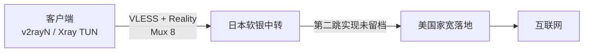

# 当前代理架构与已知缺口

## 已确认的链路

- 当前入口/中转使用日本软银线路，最终出口是美国住宅网络。[Source: User, 当前对话, 2026-07-18]
- 2026-07-28 实机状态显示客户端使用 v2rayN 7.22.7 + Xray 26.6.1 TUN，通过 VLESS + Reality 连接日本入口；Mux 已启用，并发数为 8。[Source: live process、SQLite profile 与生成配置, 2026-07-28]
- 服务器管理使用 x-ui；用户截图确认美国侧至少存在 `us-reality`（8443）与 `us-socks` 入站，日本侧面板/第二跳实现仍未留档。[Source: User screenshot 与本地资料缺口审计, 2026-07-28]

## 2026-07-28 已核实的客户端行为

- 所有公网 TCP 流量由 catch-all 规则走代理；只保留私网直连，不再对中国域名或 IP 做公网直连。[Source: active Xray routing rules, 2026-07-28]
- 公共 DNS 为 Cloudflare DoH，并由 `dns-module -> proxy` 规则经美国出口查询；Windows 两个活动网卡均使用 `1.1.1.1 / 1.0.0.1`。[Source: active Xray DNS/routing 与 Windows adapter state, 2026-07-28]
- 六个独立 IP 查询服务一致看到同一个美国住宅出口；IPInfo 将其归为 AS5650 Frontier Communications of America。[Source: live multi-source exit verification, 2026-07-28]
- Mux 8 正式复测：curl 五站并行 40/40 成功、整体总耗时中位数 1122 ms；Edge 按 CleanIP 的浏览器请求方式复现为 39/40 成功、整体中位数 240 ms，首轮之后 35/35 成功。修改前基线为 33/40 成功、单站中位数约 1860–2371 ms；固定下载没有观察到吞吐下降。[Source: local benchmark, 2026-07-28]
- TUN MTU 暂时维持 9000；物理路径 PMTU 为 1500，但当前没有丢弃/错误证据，因此 MTU 1500 仅保留为后续单变量候选，不与 Mux 同时修改。[Source: live adapter counters、DF probe 与 Xray config, 2026-07-28]

## 最新候选客户端配置

`private-configs/04-jp-softbank-us-lineage/latest-candidate/wangbin-1dbki5bk.json` 是 2026-07-17 留存的 sing-box 历史候选，不是 2026-07-28 已核实的活动客户端配置；当前活动状态以上述 v2rayN/Xray 实机证据为准。[Source: 文件修改时间、live process 与生成配置, 2026-07-28]

它的行为是：

- 使用 gVisor TUN 栈、自动路由和 XUDP 封包。[Source: latest-candidate 配置, 2026-07-17]
- 默认 DNS 经代理解析；中国域名使用另一条直连 DoH 解析路径。[Source: latest-candidate 配置的 dns.servers 与 dns.rules, 2026-07-17]
- 对流量做 sniff 和 DNS 劫持；私网、中国域名及中国 IP 直连，其余流量进入代理出站。[Source: latest-candidate 配置的 route.rules, 2026-07-17]
- 依赖三套远程 geosite/geoip 规则集，并启用规则缓存；规则源不可用时，国内分流可能退化或更新失败。[Source: latest-candidate 配置的 route.rule_set 与 experimental.cache_file, 2026-07-17]

其备份文件保留同一套核心接入材料，但没有后来加入的国内直连、DNS 分流和规则集逻辑。[Source: latest-candidate 与 backup 配置比较, 2026-07-17]

## 能从文件确认什么

| 层级 | 可确认内容 | 证据 |
|---|---|---|
| 客户端 | TUN、DNS、路由、VLESS/Reality 接入方式 | 16 份 sing-box 配置 |
| 日本入口谱系 | `jp-us-7.4*` 与 `wangbin-*` 属于同一入口主机谱系，但凭据/入口参数有过更新 | 脱敏字段指纹比较 |
| 国内分流 | 最新候选配置把私网和中国域名/IP 直连 | 最新候选配置 |
| 香港历史 | 曾使用香港入口，并密集测试 DNS、UDP、Vision flow 和备用节点 | `sing-box-hk-*` 文件族 |
| 流量监控 | 曾用 vnStat + GitHub Pages 监控香港中转账期流量 | `hk-traffic-monitor` Git 项目 |

[Source: compiled from private-configs 文件族与 hk-traffic-monitor Git 历史, 2026-07-18]

## 目前无法确认什么

以下资料在本目录中不存在，不能从客户端配置反推：

- 日本节点与美国家宽之间实际使用的协议、进程和路由方式。
- x-ui 的分支/版本、安装节点、面板地址、入站、出站和用户状态。
- Reality 服务端私钥、服务端证书策略和完整 Xray 配置。
- SSH 登录、系统发行版、防火墙、系统服务、定时任务和自动更新方式。
- 两台服务器的提供商、续费日、流量额度、IP 变更方式和故障联系人。
- 哪些历史 UUID/入站已经撤销，哪些仍然有效。

[Source: 本地文件清单与敏感字段审计, 2026-07-18]

补齐这些信息时使用 [接管信息模板](05-接管信息模板.md)，只写密码库记录名，不要把密码、UUID、密钥或完整端点复制进知识库。
